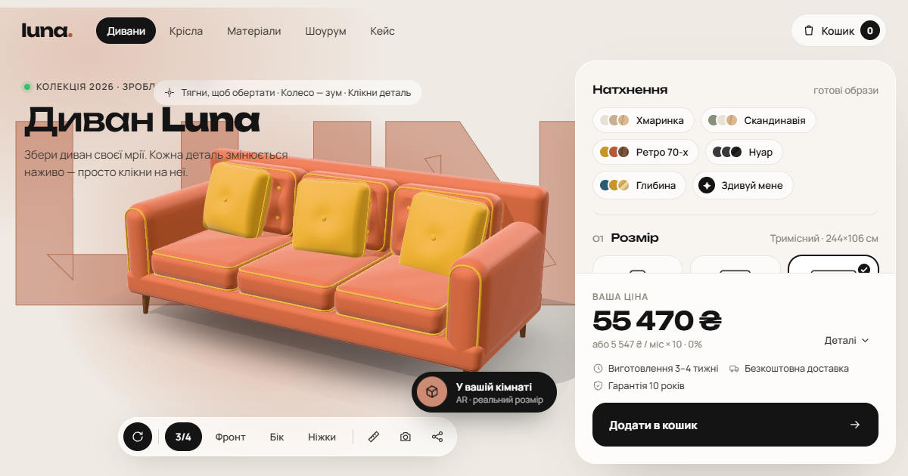

# Luna — 3D furniture configurator

A site for a fictional European sofa brand. The centrepiece is a 3D configurator: change size, fabric, colour, legs and details, and the price updates as you go. Try it in your room with AR, in English, German or Ukrainian.



## Pages

| Page | What's there |
| --- | --- |
| **Sofas** (`index.html`) | 3D configurator: 3 sizes, 4 fabrics, 9 colours, 3 leg styles, 4 finishes, piping, capitonné, cushions (≈1.7 million combinations). The model assembles itself, parts are clickable, dimensions in cm, PNG snapshot, shareable URL, **AR "in your room"**. |
| **Armchairs** (`armchairs.html`) | Six ready-made looks. Catalogue photos are rendered in the browser from the same 3D model. |
| **Materials** (`materials.html`) | 3D fabric sample with macro mode, composition and Martindale durability, palette, finishes, care. Free sample kit. |
| **Showrooms** (`showroom.html`) | Berlin and Warsaw with live "open now" in the local time zone, visit booking with date/time slots, `.ics` calendar export, FAQ. |
| **Case study** (`case.html`) | Portfolio write-up: problem, solution, an interactive 5-step breakdown of how a cushion is generated, height and normal maps, architecture. |
| **Legal** (`legal.html`) | Imprint and privacy policy. |

A shared cart lives in `localStorage`, syncs across tabs and re-translates when the language changes. Checkout covers EU countries (names from `Intl.DisplayNames`), postcode, PayPal/card/instalments and a consent checkbox.

## Made for Europe

- **Three languages:** English, German (formal "Sie"), Ukrainian. The language is detected from the browser, can be switched in the header or footer, and is remembered; `?lang=de` forces one.
- **Euro pricing incl. VAT**, formatted per locale (`€1,660`, `1.660 €`, `1 660 €`), with instalments shown at 0% APR.
- **GDPR-friendly by design:** no cookies, no analytics, no third-party requests. Fonts, Three.js, model-viewer and the QR library are all self-hosted, so no cookie banner is needed.
- EU-specific copy: free delivery across the EU, NO, CH and the UK, an honest note on the right of withdrawal for custom furniture, a 2-year statutory guarantee and a 10-year frame warranty.

## Technical

- **Three.js r169**, self-hosted under `vendor/` and loaded via an import map. No build step: plain HTML, CSS and ES modules.
- **Not a single 3D file.** Geometry (soft boxes with domed tops, wrinkles, piping and capitonné buttons) and fabric textures (bouclé, velvet, leather, linen, wood) are generated by code. Textures are drawn on a canvas and turned into normal maps.
- **AR without a server:** the current configuration is exported to GLB in the browser (`GLTFExporter`); [model-viewer](https://modelviewer.dev) launches WebXR on Android and Quick Look on iPhone. Desktop shows a QR code for the phone.
- **i18n without a framework:** static copy carries `data-i18n` keys with the English text as the no-JS fallback; dynamic copy goes through `t()`.

```
js/
  config.js          options, prices (EUR), presets
  i18n.js            language detection, t(), Intl formatting
  locales/           en.js, en.static.js (generated), de.js, uk.js
  sofa.js            procedural model
  textures.js        procedural textures
  studio.js          shared 3D scene, materials, tweens
  shell.js           header, language switcher, cart, checkout, footer
  ar.js              GLB export, AR dialog, QR
  main.js            configurator
  armchairs.js · materials-page.js · showroom.js · case.js
tools/i18n.py        extracts English from the HTML and checks DE/UK cover every key
vendor/              three.js, model-viewer, qrcode-generator
assets/fonts/        Manrope and Unbounded (SIL OFL)
```

## Run locally

ES modules don't load over `file://`, so use any static server:

```bash
python -m http.server 8000
```

Then open http://localhost:8000.

## Adding or changing copy

1. Edit the English text in the HTML (or in `js/locales/en.js` for strings rendered from JavaScript).
2. Run `python tools/i18n.py`: it regenerates `en.static.js` and lists every key German or Ukrainian is missing.
3. Add the translations to `js/locales/de.js` and `js/locales/uk.js`.

## Deploy

The site is fully static. GitHub Pages (branch `main`, repository root), Netlify or Vercel work with no build settings.

---

Luna is a fictional brand; addresses and phone numbers are made up. Orders and bookings are never sent anywhere.
